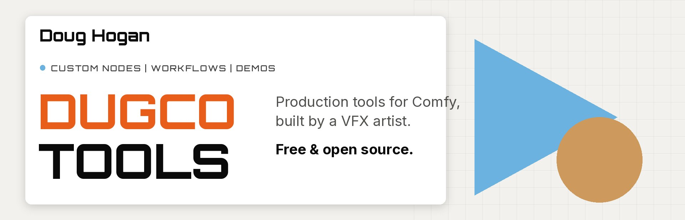
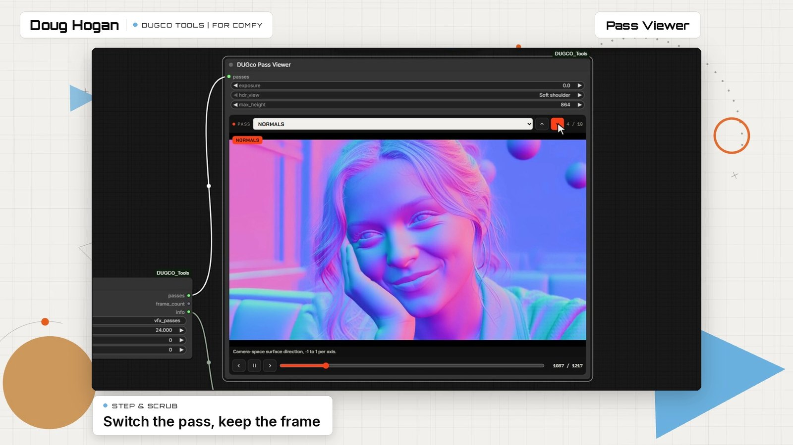
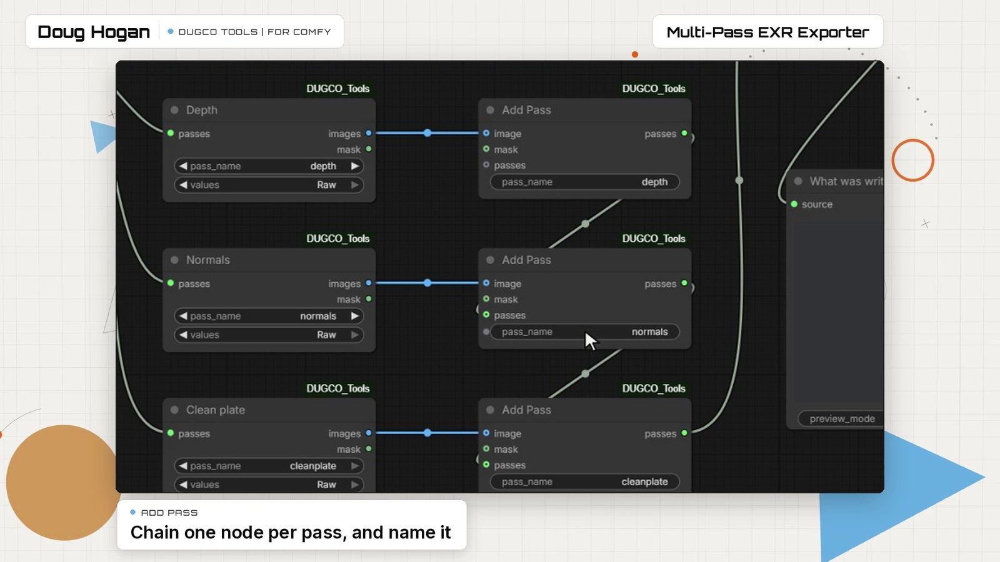
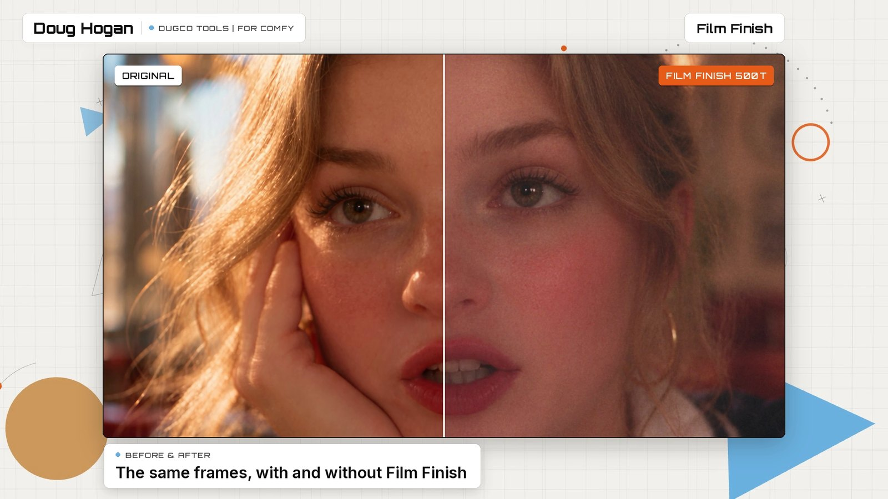
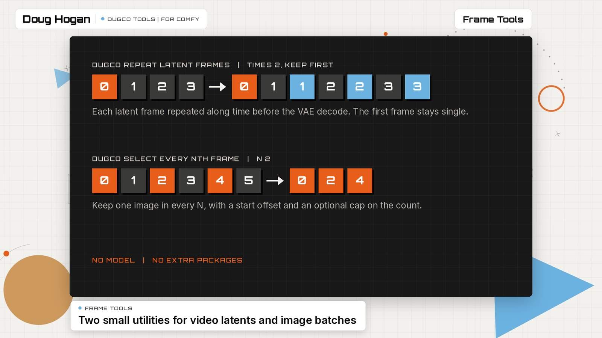
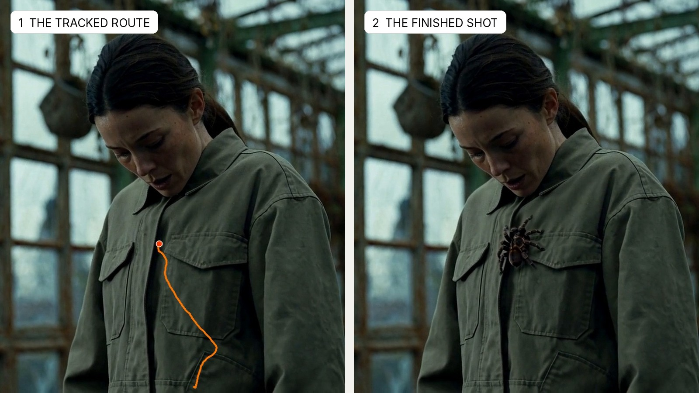
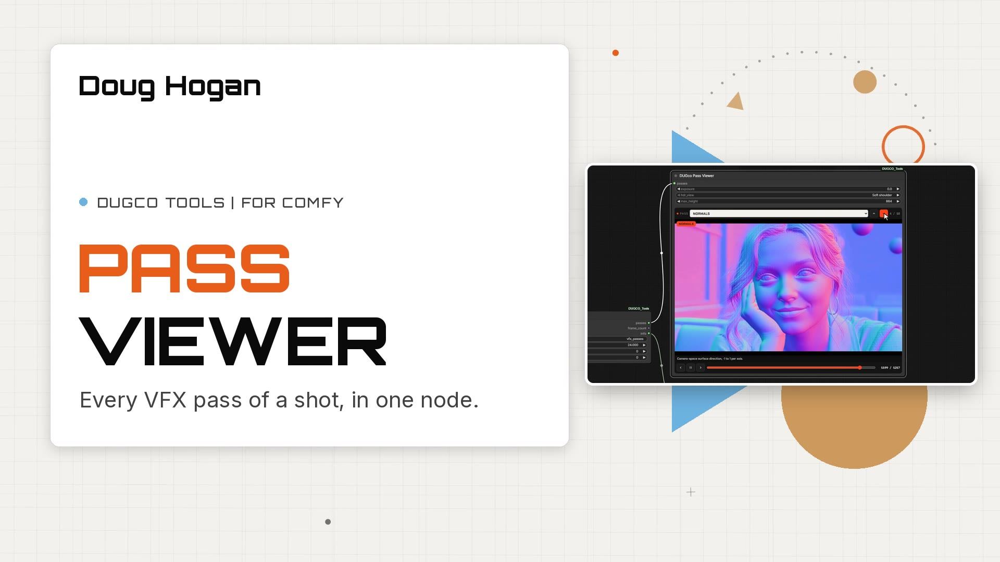
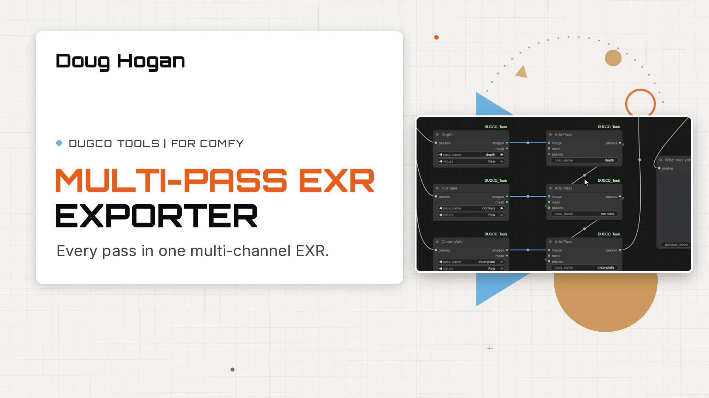
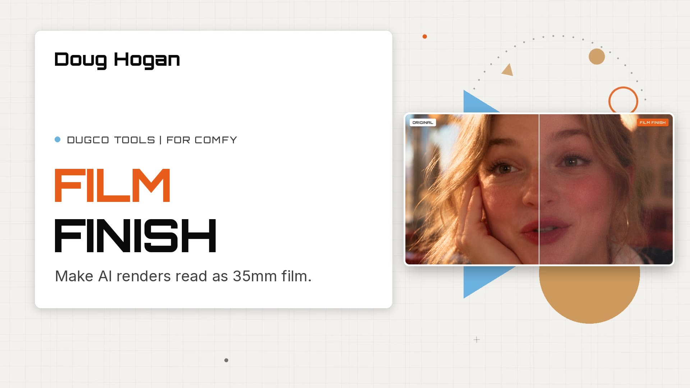

<p align="center">
  
</p>

# DUGCO Tools

A growing pack of custom nodes and workflows for [ComfyUI](https://github.com/comfyanonymous/ComfyUI), built by Doug Hogan for real VFX and finishing work. Every tool here solves a problem that came up on a shot. New tools are added as they are published.

**[Install](#install)** · **[Demo videos](#demo-videos)** · **[Let an agent install it](#let-an-agent-install-it)** · **[Workflows](#workflows)** · **[Requirements](#what-each-tool-needs)**

## The tools

| Tool | What it does | Nodes |
| --- | --- | --- |
| [Pass Viewer](#pass-viewer) | Step through every VFX pass of a shot inside one node. | 4 |
| [Multi-Pass EXR Exporter](#multi-pass-exr-exporter) | Write all of your passes into one multi-channel EXR per frame. | 2 |
| [Film Finish](#film-finish) | Make AI renders read as 35mm film. | 1 |
| [Frame Tools](#frame-tools) | Repeat video latent frames, and keep every Nth image. | 2 |
| [Track Path To Shot](#track-path-to-shot) | Draw a route on frame 1 and it sticks to the surface for the whole shot. | 1 |

All nodes appear under the **DUGco** category in the node menu.

---

### Pass Viewer



Beauty, alpha, albedo, normals, depth, shading, specular, roughness, metallic and clean plate, all in one node.

- Point it at a folder of multi-layer EXR frames and it lists whatever passes it finds.
- Switching pass keeps the frame, so you can compare passes directly. Scrub, play and step with the keyboard.
- The beauty is treated as HDR: pull the exposure down to see what is held in the highlights.
- No EXRs yet? **Passes From Images** bundles image batches from any workflow into a pass set, and **Pick Pass** pulls one pass back out as an image and a mask.

**Nodes:** DUGco Load VFX Pass EXRs · DUGco Passes From Images · DUGco Pass Viewer · DUGco Pick Pass
&nbsp;|&nbsp; [Watch the demo](demos/pass_viewer/demo.mp4) &nbsp;|&nbsp; [Guide](docs/pass_viewer.md) &nbsp;|&nbsp; [Example workflow](example_workflows/DUGco%20Pass%20Viewer%20-%20VFX%20Passes.json)

---

### Multi-Pass EXR Exporter



Chain an **Add Pass** node for each pass you want, give it a name, and the exporter writes one multi-channel EXR per frame.

- Every pass gets its own named channels (`depth.Z`, `normals.R/G/B`, `cleanplate.R/G/B`), so nothing overwrites the beauty.
- sRGB input is converted to scene-linear, or linear is written as it is.
- IMAGE or MASK inputs, 32-bit float or 16-bit half, with your own start frame.
- The files open straight back into the Pass Viewer.

**Nodes:** Multi-Pass EXR Exporter · Add Pass
&nbsp;|&nbsp; [Watch the demo](demos/exr_multi_pass_exporter/demo.mp4) &nbsp;|&nbsp; [Guide](docs/exr_multi_pass_exporter.md)

---

### Film Finish



One node that makes AI and digital renders read as if they were shot on 35mm film. Put it after the decode and before you save.

- Pulls back the crunchy micro-contrast of AI renders without haloing edges.
- Adds a film curve, highlight rolloff, halation round small highlights, per-frame grain and gate weave.
- Two stocks: **500T** for more grain and glow, **250D** for a cleaner daylight look.
- Works on stills and video. Long clips can be processed in pieces without the grain restarting.

**Nodes:** DUGco Film Finish
&nbsp;|&nbsp; [Watch the demo](demos/film_finish/demo.mp4) &nbsp;|&nbsp; [Guide](docs/film_finish.md) &nbsp;|&nbsp; [Example workflow](example_workflows/DUGco%20Film%20Finish%20-%20video.json)

---

### Frame Tools



Two small utilities with no model and no extra packages.

- **Repeat Latent Frames** repeats each frame of a video latent along time before the VAE decode. It can leave the first latent frame single and limit how many frames are used.
- **Select Every Nth Frame** keeps one image in every N, with a start offset and an optional cap on the count.

**Nodes:** DUGco Repeat Latent Frames · DUGco Select Every Nth Frame
&nbsp;|&nbsp; [Guide](docs/frame_tools.md)

---

### Track Path To Shot



For the classic "insert creature here" shot. Draw a route on the first frame and the node keeps it on the surface it was drawn on, so a mask can crawl up a jacket while the actor moves.

- Draw the route in the KJNodes Spline Editor, over frame 1 of your shot.
- The node tracks points along the route through the shot and gives you one position per frame, with a start and end frame for the move.
- Feed that to Create Shape Mask On Path for a travelling mask, and check the built-in preview before you render.
- The **Animated Path Insert** workflow uses it with MiniMax H3 to add a spider that climbs a jacket, and saves a matte and an RGBA element for your comp.

**Licence:** the tracker it downloads, CoTracker3, is **CC-BY-NC 4.0: non-commercial use only**. The node's own code is MIT.

**Nodes:** DUGco Track Path To Shot
&nbsp;|&nbsp; [Watch the result](demos/animated_path_insert/demo.mp4) &nbsp;|&nbsp; [Node guide](docs/track_path.md) &nbsp;|&nbsp; [Workflow guide](docs/animated_path_insert.md) &nbsp;|&nbsp; [Example workflow](example_workflows/DUGco%20Animated%20Path%20Insert%20-%20MiniMax%20H3.json)

---

## Install

Clone the pack into your ComfyUI `custom_nodes` folder:

```bash
git clone https://github.com/dughogan/DUGCO_Tools.git
```

Install the Python requirements with **the same Python that runs ComfyUI**, then restart ComfyUI:

```bash
python -m pip install -r DUGCO_Tools/requirements.txt
```

Check the install at any time:

```bash
python DUGCO_Tools/scripts/check_install.py
```

To update later, run `git pull` inside the `DUGCO_Tools` folder and restart ComfyUI.

**Already have one of these as a separate pack?** Remove the standalone copy first (for example `exr_multi_pass_exporter` or `ComfyUI-DUGco-FrameTools`). Two packs that register the same node will clash. The checker lists any it finds.

### Let an agent install it

If you use a coding agent (Claude Code, Codex, Cursor and others), it can do the install for you, including finding the right Python and the extra pieces some tools need. Give it this:

> Install the DUGCO Tools pack for my ComfyUI by following https://github.com/dughogan/DUGCO_Tools/blob/main/AGENTS.md

[AGENTS.md](AGENTS.md) has the full steps, the checks to run and the fixes for common problems.

## What each tool needs

| Tool | Extra requirements |
| --- | --- |
| Pass Viewer | `OpenEXR`, `av`, `opencv-python` (in `requirements.txt`) |
| Multi-Pass EXR Exporter | `OpenEXR`, `Imath` (in `requirements.txt`) |
| Film Finish | None |
| Frame Tools | None |
| Track Path To Shot | `opencv-python` (in `requirements.txt`); [KJNodes](https://github.com/kijai/ComfyUI-KJNodes) for the Spline Editor; CoTracker3, downloaded on first use (non-commercial licence) |

## Workflows

Workflows live in [example_workflows](example_workflows) and also appear in ComfyUI's Templates browser once the pack is installed. The Film Finish workflow uses [Video Helper Suite](https://github.com/Kosinkadink/ComfyUI-VideoHelperSuite) to load and save clips.

| Workflow | What it does |
| --- | --- |
| [DUGco Pass Viewer - VFX Passes](example_workflows/DUGco%20Pass%20Viewer%20-%20VFX%20Passes.json) | Load a folder of multi-layer EXR frames and step through every pass. |
| [DUGco Film Finish - video](example_workflows/DUGco%20Film%20Finish%20-%20video.json) | Load a clip, apply the film finish, save at a grain-safe bitrate. |
| [DUGco Animated Path Insert - MiniMax H3](example_workflows/DUGco%20Animated%20Path%20Insert%20-%20MiniMax%20H3.json) | Draw a route, track it onto the shot, and have MiniMax H3 paint a creature along it. Needs the MiniMax H3 models, KJNodes and MaskVidExperiments: see the [guide](docs/animated_path_insert.md), or [let an agent set it up](docs/animated_path_insert_agents.md). |

## Demo videos

A 45-second narrated walkthrough of each tool.

| | | |
| :---: | :---: | :---: |
| [](demos/pass_viewer/demo.mp4) | [](demos/exr_multi_pass_exporter/demo.mp4) | [](demos/film_finish/demo.mp4) |
| [Pass Viewer](demos/pass_viewer/demo.mp4) | [Multi-Pass EXR Exporter](demos/exr_multi_pass_exporter/demo.mp4) | [Film Finish](demos/film_finish/demo.mp4) |

## What's in the repository

| Folder | Contents |
| --- | --- |
| `nodes/` | One Python file or folder per tool. Loaded automatically. |
| `web/js/` | Front-end code for nodes with custom UI. |
| `example_workflows/` | Workflow `.json` files and their thumbnails. |
| `docs/` | A guide for each tool, and the images on this page. |
| `demos/` | Short demo clips, one folder per tool or workflow. |
| `scripts/` | The install checker. |
| `tests/` | A smoke test that checks the pack loads and the nodes run. |

Adding a tool to the pack? The checklist is in [CONTRIBUTING.md](CONTRIBUTING.md).

## License

[MIT](LICENSE)
