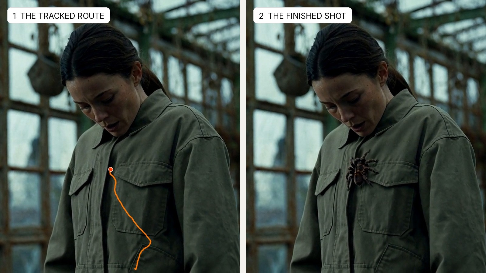

# DUGco Animated Path Insert (MiniMax H3)

A workflow for the classic "insert creature here" shot. You draw a route on frame 1, the route is tracked onto the surface, and MiniMax H3 paints the creature along it. The example is a spider climbing a jacket.

[Workflow](../example_workflows/DUGco%20Animated%20Path%20Insert%20-%20MiniMax%20H3.json) &nbsp;|&nbsp; [Example result](../demos/animated_path_insert/demo.mp4) &nbsp;|&nbsp; [Let an agent set it up](animated_path_insert_agents.md) &nbsp;|&nbsp; [The tracking node](track_path.md)

> **Licence.** The route tracker downloads CoTracker3, which is **CC-BY-NC 4.0: non-commercial use only**. MiniMax H3 and SAM 3.1 have their own licences; read them before using the results commercially.

## What it gives you

| Output | Saved as |
| --- | --- |
| The tracked route, to check first | `output/path_insert/route_preview_*.mp4` |
| The finished shot, with the plate's sound | `output/path_insert/comp_*.mp4` |
| A matte of the creature | `output/path_insert/matte_*.mp4` |
| The creature as an RGBA PNG sequence (straight alpha) | `output/path_insert/element/creature_*.png` |

Everything outside the creature is your original footage.

## What it needs

**Node packs**

- DUGCO Tools (this pack), for **DUGco Track Path To Shot**
- [ComfyUI-KJNodes](https://github.com/kijai/ComfyUI-KJNodes) (Spline Editor, Create Shape Mask On Path, Set/Get)
- [MaskVidExperiments](https://github.com/drozbay/MaskVidExperiments) (Subject Crop, Subject Uncrop, Mask To Latent Space)

**Models**

| File | Folder |
| --- | --- |
| `minimax_h3_ref2va_pruned_int8_convrot.safetensors` | `diffusion_models` |
| `qwen3vl_32b_minimax_h3_nvfp4_awq.safetensors` | `text_encoders` |
| `minimax_h3_video_vae_fp16.safetensors` | `vae` |
| `minimax_h3_audio_vae_fp32.safetensors` | `vae` |
| `sam3.1_multiplex_fp16.safetensors` | `checkpoints` |

Download addresses and sizes are in the [agent instructions](animated_path_insert_agents.md#step-5-models).

**Example inputs.** Copy `example_workflows/inputs/path_insert_plate.mp4` and `path_insert_spider.jpg` into ComfyUI's `input` folder.

It was built and tested on ComfyUI 0.45.0 with a 96 GB GPU. One 8-second pass took about 15 minutes there. It has not been tested on smaller cards.

## How to use it

1. **Load your shot** in group 2.
2. **Run once**, so frame 1 appears in the Spline Editor in group 3.
3. **Draw the route.** The first point is where the creature starts, the last is where it ends. Shift+click adds a point at the end, Ctrl+click adds one between two points, right-click deletes one.
4. **Set the timing** on Track Path To Shot (`start_frame`, `end_frame`) and the **creature size** on the mask node. About 1.5x the body you want gives H3 room for legs.
5. **Describe the creature** in group 4 and load a reference picture of it on a plain background. Call the picture `<Picture 1>` in the description.
6. **Run.** Look at the route preview first. If the dot stays on the surface, let the render finish.

For another take, change the seed in group 5.

## How the example shot was made

1. **The plate.** A still from MiniMax H3 Image, animated with MiniMax H3 image-to-video. The direction was written into the prompt: she stands unaware, then feels something, looks down at her chest and freezes. Nothing is on the jacket in the plate.
2. **The eyeline.** At six seconds she is looking at the placket between the two chest pockets. That same spot was found on frame 1, and the route ends there.
3. **The timing.** The move ends just before she looks down, so the spider is already waiting when her eyes arrive.
4. **The creature.** A reference picture of a tarantula, and a description of how it walks and how the light falls on it.

## How it works

1. **Route to mask.** The Spline Editor's route goes through Track Path To Shot, which follows the cloth, and Create Shape Mask On Path turns it into a travelling circle.
2. **Crop.** The whole route is cropped out of the shot and enlarged, so a small creature still gets enough pixels.
3. **Inpaint.** The crop is encoded, and only the mask is regenerated. H3 sees the real jacket all around the hole, so the creature it paints sits in the same light and on the same cloth.
4. **Paste back.** The crop goes back into the shot through a soft copy of the mask.
5. **Matte.** SAM 3.1 finds the creature in the finished shot, limited to the travelling mask, for the matte and the RGBA element.

## Limits

- **The creature is generated, not animated by hand.** You control where it goes and when, not each leg. On the example, the legs read well in motion but are not a countable eight on every frame.
- **Up to 15 seconds per render**, cut to H3's frame grid (17n+5 frames).
- **The surface must be visible on frame 1** and reasonably textured. See the [node guide](track_path.md#limits).
- **It needs a lot of GPU memory.** If it runs out, lower "Crop detail (megapixels)" in group 5 or use a shorter shot.
- **Not on Comfy Cloud yet**: the tracking node is a local custom node.
