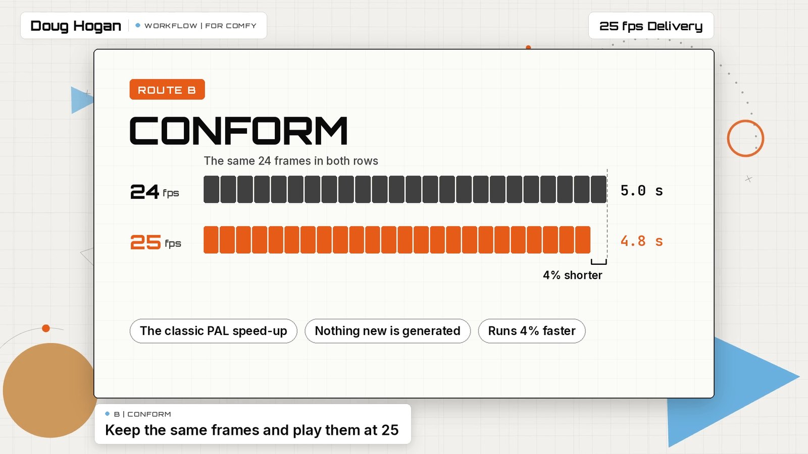

# DUGco 25 fps Delivery (Native, Conform, Retime)

One workflow that shows three ways to deliver 25 fps video from ComfyUI when most video models give you 24. Which route you use depends on one question: does the model let you choose the frame rate?

[Workflow](../example_workflows/DUGco%2025%20fps%20Delivery%20-%20Native%20Conform%20Retime.json) &nbsp;|&nbsp; [Watch the explainer](../demos/fps25_delivery/demo.mp4)

| Route | How | Use it when | Trade-off |
| --- | --- | --- | --- |
| **A, Native 25** | LTX 2.5, with the frame rate set while it generates | the model takes a frame rate | none: every frame is made for 25 |
| **B, Conform** | Get Video Components, then Create Video at 25 (core nodes) | the clip is 24 fps and has no sync sound | plays 4% faster (5.0 s becomes 4.8 s), picture only |
| **C, Retime** | Topaz Video Enhance with the upscaler off, interpolating to 25 | the clip is 24 fps and its length must hold | new in-between frames are generated |

This workflow adds no DUGCO Tools node. It ships with the pack so it appears in the Templates browser.

## How to use it

1. Open the workflow. In **group 1**, write a prompt and set the length. The delivery frame rate is already 25.
2. Press **Run**. Three files are saved to `output/25fps/`: `A_native_LTX25`, `B_conform` and `C_retime_Topaz`.
3. To convert a MiniMax H3 clip instead of a Seedance clip, turn on the switch in group 1.

The nodes titled "Frame rate, 1 of 3", "2 of 3" and "3 of 3" are every place Route A sets a frame rate. To skip a route, select its group and mute it (Ctrl+M).

## Which model does what

- **LTX 2.5** takes the frame rate as an input. It goes in three places: the conditioning, the audio latent and the saved file. All three read the value from group 1. LTX frame counts are 8n+1, so 5 seconds at 25 fps is 121 frames (4.84 s).
- **MiniMax H3** open weights are trained at 24 fps and have no frame-rate input, so H3 is a 24 fps source.
- **Seedance 2.5** returns 24 fps and has no frame-rate input. Any other 24 fps generator, or a Load Video node, can take its place in group 4.

## What it needs

- ComfyUI core 0.45 or newer.
- [ComfyUI-KJNodes](https://github.com/kijai/ComfyUI-KJNodes), for the Set and Get nodes.
- **Route A:** the LTX 2.5 files named in group 2.

  | File | Folder |
  | --- | --- |
  | `ltx-2.5-22b-distilled-transformer-comfy-int8-convrot.safetensors` | `diffusion_models` |
  | `gemma4-12b-with-proj-ltx-2.5-comfy-int8-convrot.safetensors` | `text_encoders` |
  | `ltx-2.5-video-vae-bf16.safetensors` | `vae` |
  | `ltx-2.5-audio-vae-bf16.safetensors` | `vae` |

- **Routes B and C from Seedance, and Route C's Topaz retime:** a Comfy account with credits, because these are partner nodes. Each run is billed. No local models.
- **Routes B and C from MiniMax H3** (the switch in group 1): the MiniMax H3 files named in group 5 (`diffusion_models`, `text_encoders`, `vae`).

The models have their own licences. Read them before using the results commercially.

## Group 9

An alternative retime with ByteDance vCube (`fps` set to 25). It also cleans up and sharpens the picture, so it is muted by default so that a run is not billed twice. Use it in place of group 8 when you want an enhance or upscale pass in the same step.

## Limits

- **Conform changes the speed.** The clip is 4% shorter and the sound is left off, because it would drift out of sync. For dialogue or music, use the retime.
- **Retime invents frames.** Interpolation can smear fast or fine motion. Check the result at full speed.
- **Native needs a model that takes a frame rate.** Of the three generators here, only LTX 2.5 does.

## What has been tested

Run on ComfyUI core 0.45.0 on 2026-11-13:

| Route | Result |
| --- | --- |
| A, Native (LTX 2.5) | Ran. The saved file is 1280 x 704, 121 frames at 25 fps, with sound. |
| B, Conform, from a MiniMax H3 clip | Ran. The 124 frames H3 made at 24 fps were saved at 25 fps (4.96 s), picture only. |
| Seedance 2.5 as the 24 fps source | Not run yet. |
| C, Retime (Topaz), and the vCube alternative in group 9 | Not run yet. On your first run, check that the retimed file still carries its sound. |

The untested parts are partner nodes that bill a Comfy account. Every node and option name in them was checked against core 0.45.0.

