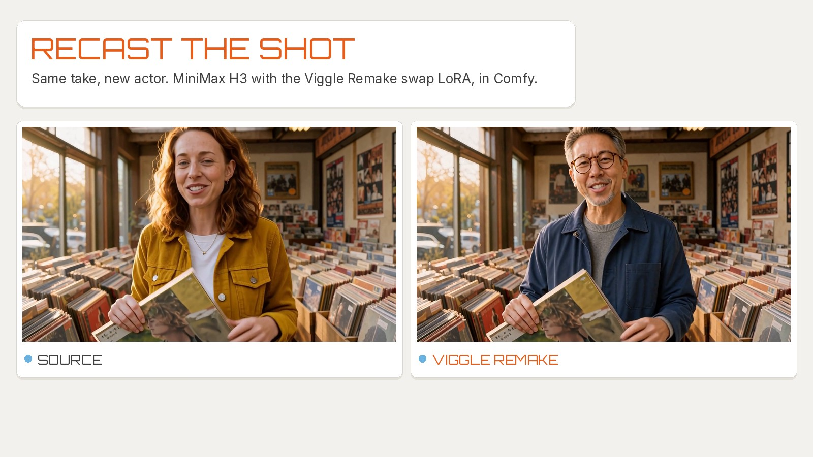

# DUGco Viggle Remake Character Swap (MiniMax H3)

One workflow that recasts the person in a shot: a different actor, a new head on the same body, a costume change, or a robot. It uses MiniMax H3 with the [Viggle Remake](https://huggingface.co/Viggle/Viggle-Remake) swap LoRA. There is no mask and no tracking. You repaint two frames of your shot with the new character, and the model re-shoots the whole clip to pass through them.

[Workflow](../example_workflows/DUGco%20Viggle%20Remake%20Character%20Swap%20-%20MiniMax%20H3.json)

This workflow adds no DUGCO Tools node. It ships with the pack so it appears in the Templates browser.

## How it works

| Step | Group | What happens |
| --- | --- | --- |
| Your shot | 1 | A 24 fps clip, trimmed to the length you set. Its motion, camera, set and sound are the guide. |
| Keyframes | 3 | Two frames are pulled from the shot and repainted with the new character by FLUX 3 Klein. The second is painted with the first as its identity reference. |
| Prompt | 4 | A six-section MiniMax prompt that describes the finished video. |
| Render | 5 | MiniMax H3 (the first/last-frame model) with the swap LoRA. Each keyframe is pinned to the frame it was painted from. Six steps. |
| Result | 6 | Picture plus the source soundtrack. |

The two painted frames are the identity. Everything the model knows about the new character comes from them, so look at both previews in group 3 before you trust a render.

## How to use it

1. Copy the three example files from `example_workflows/inputs` (`viggle_remake_shot.mp4`, `viggle_remake_keyframe_1.jpg`, `viggle_remake_keyframe_2.jpg`) to ComfyUI's `input` folder, or load your own shot in **group 1**.
2. Set **Length in frames** to a valid count no longer than your clip: 17n + 5, for example 124, 175, 226 or 294. Viggle recommends at most 294 (about 12 seconds).
3. In **group 3**, choose two frame numbers where the person is clearly visible: one early, one late, ideally one wide and one close. Write the paint instruction: who replaces whom, and what must stay.
4. In **group 4**, describe the finished video. Keep the six section names. `<Video 1>` is your shot, `<Picture 1>` and `<Picture 2>` are the keyframes, `<Subject 1>` is the new character.
5. Press **Run**. To use frames you painted in another editor, load them in group 3 and turn on **Use my own painted frames**.

The kind of swap comes from the words, not from a switch:

- **Full recast:** the paint instruction replaces the whole person, and the prompt describes the new one.
- **Head swap:** the paint instruction changes only the head, and the prompt says the body and clothes are kept.
- **Costume change:** the paint instruction changes only the clothes.

## What it needs

- ComfyUI with the MiniMax H3 nodes in core.
- **ComfyUI-Viggle-Remake**, the node pack in the `comfyui/` folder of the [Viggle Remake repository](https://huggingface.co/Viggle/Viggle-Remake) (Apache 2.0).
- [ComfyUI-KJNodes](https://github.com/kijai/ComfyUI-KJNodes), for the Set and Get nodes.

| File | Folder |
| --- | --- |
| `minimax_h3_fl2va_pruned_int8_convrot.safetensors` | `diffusion_models` |
| `qwen3vl_32b_minimax_h3_int8_convrot.safetensors` | `text_encoders` |
| `minimax_h3_video_vae_fp16.safetensors`, `minimax_h3_audio_vae_fp32.safetensors` | `vae` |
| `viggle_remake_swap_comfyui.safetensors` (and `viggle_remake_edit_comfyui.safetensors` for edits) | `loras` |
| `flux3_image_klein_sd_bf16.safetensors` | `diffusion_models` |
| `qwen3vl_4b_bf16.safetensors`, `qwen3.5_9b_flux3_prompt_upsampler_int8_convrot.safetensors` | `text_encoders` |
| `flux2-vae.safetensors` | `vae` |

The FLUX 3 Klein files are only for the painting step. If you paint your own keyframes you do not need them.

## Licence

**Read this before paid work.** The Viggle Remake LoRA is a derivative of MiniMax H3, so it falls under the **MiniMax H3 Community License**, not MIT:

- a commercial product must show "MiniMax H3" prominently in its interface;
- a company whose products earn more than US$20 million a year needs written permission from MiniMax;
- redistribution must include the licence and its notice file.

Viggle also asks that you only re-shoot footage you have the right to change, with the consent of the people in it, and that you label results as AI-generated. FLUX 3 Klein has its own licence. The workflow file itself is MIT like the rest of this pack.

## Limits

- **It regenerates every pixel.** The result follows the source closely, but it is not your plate with a patch on it. For a locked plate where only the person may change, use a masked inpaint instead.
- **The keyframes decide the identity.** A weak painted frame gives a weak swap. Two frames that disagree give a character that drifts.
- **The sound passes through.** The new character keeps the old voice.
- **Bright skies can clip brighter** than the source.
- **A costume-only change slightly smooths the face.**
- **Length and rate are fixed:** 24 fps, 90 to 345 frames in steps of 17 (about 14 seconds at most), short edge 480 or 736. A longer shot has to be split.
- **480 is soft.** It is fast enough to try castings, and it is a preview. 736 is close to the source.
- **Small lettering can change** from moment to moment, because every frame is regenerated.

## What has been tested

On an RTX PRO 6000 (96 GB) with the int8 MiniMax H3 files, the same 226-frame clip each time:

| Run | Render time | Peak video memory |
| --- | --- | --- |
| 480 (832 x 480), cold start | about 7 minutes | 55 GB |
| 480, models already loaded | about 2.5 minutes | |
| 736 (1280 x 736), cold start | a little over 14 minutes | 72 GB |
| For comparison: MiniMax H3 masked inpaint, no LoRA, cold start | almost 18 minutes | 56 GB |

Eleven swaps were run: full recasts, head swaps, costume changes and a robot, on one generated clip with speech and on six stock clips. A recast of real footage with real recorded speech kept its lip sync. Results were judged on stills and side-by-side playback.

**Resolution above 736.** Viggle documents 480 and 736, and the node stops at 736. With a test-only copy of the node that allows more, 1920 x 1088 rendered and was visibly sharper, but only for 90 frames (about four seconds, 81.5 GB). 1536 x 864 worked for 124 frames. A full 226-frame take ran out of memory at anything above 736 on this card. Treat 480 as a preview size and 736 as the delivery size for a whole take.

## The Edit LoRA: change everything except the person

Remake ships a second LoRA, `viggle_remake_edit_comfyui.safetensors`. The swap LoRA changes who is in the shot; the Edit LoRA changes the rest: a new location, a relight, or an added object. It runs in this same workflow:

1. In the models group, pick the edit LoRA file instead of the swap one.
2. Paint the change into **one** frame and leave the person alone. Load it with **Use my own painted frames**, or write the paint instruction so it changes the setting and keeps the person.
3. In the prompt, start the summary with `[video editing]`, describe the new setting as its own subject, and mark the person as `fully_preserved`.

Three edits were tested on the example shot: the record shop replaced by a seaside flea market, the same shop at night in the rain with a neon sign, and a cat added on a crate.

**Use one painted frame for these, not two.** Two frames painted separately never agree exactly on where the new background is, and the model has to pass through both, so the background slides behind the person as the camera moves. Measured as how far the background strays from the source camera move (pixels at 832 x 480):

| Edit | Two painted frames | One painted frame |
| --- | --- | --- |
| New location | 48 px, visibly sliding | 7 px |
| Night relight | 25 px | 4 px |
| Added cat | 12 px, and the cat grew toward camera | 1.4 px |

Two frames are still right for a recast, where the second one shows the new person from a new angle.

**A relight has to relight the person too.** If the paint instruction only changes the room, the daylight rim stays on the actor. Say how they are lit in the new scene (which side is in shadow, what colour rims them), in the paint instruction and in the prompt.
